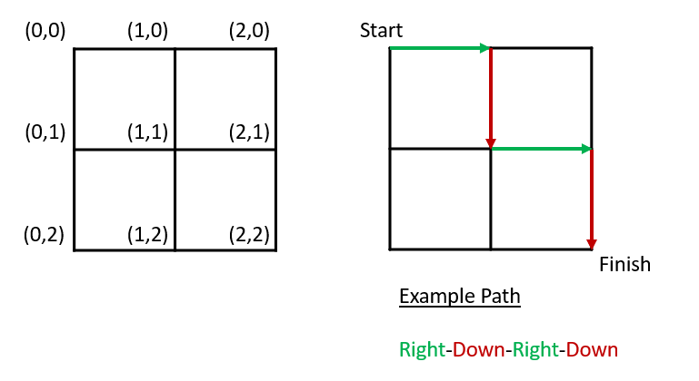

# Memoization (Advanced)

Make sure you have read the lesson first - [Memoization (Advanced)](https://samtoneill.github.io/programming_in_python/unit_8/memoization_advanced.html)

# === TASK ===

**Please note that this is an advanced topic and you are by no means expected to be able to do this straight away. In fact you shouldn't worry if you can't complete it. If you are struggling then I would move on.**

We have a grid. Your goal is to walk through the grid from start to finish by only moving right or down. 



How many paths are there from the start to the finish given that we can move right or down?

For the two by two grid given in the example we have the following paths.

```
RRDD
RDRD
RDDR
DRRD
DRDR
DDRR
```

To solve this we can turn to recursion. 

If we look at the number of paths at the end ``(2,2)`` we can note that they will actually be the sum of the number of paths to ``(1,2)`` and ``(2,1)``.

Similarly the number of paths from ``(1,2)`` are the sum of the number of paths to ``(0,2)`` and ``(1,1)``.

The number of paths on the edge, such as ``(0,2)`` are the just the number of paths from ``(0,1)`` (that is you can only get to ``(0,2)`` from ``(0,1)``.

Once we get back to the start ``(0,0)`` there is just 1 path, that is, the start.

We actually have the following:

```
if we are not on an edge
  no_paths(x,y) = no_paths(x-1,y) + no_paths(x,y-1)
  
if we are on an edge left x = 0
  no_paths(0,y) = no_paths(0, y-1)
  
if we are on an edge left y = 0
  no_paths(x,0) = no_paths(x-1, 0)
  
if we are at the start (0,0)
  no_paths(0,0) = 1
```

We can now write this as a recursive function as follows:

```python
def no_paths(x,y):
  if x == 0 and y == 0:
    return 1
  elif x == 0:
    return no_paths(0, y-1)
  elif y == 0:
    return no_paths(x-1, 0)
  else:
    return no_paths(x-1, y) + no_paths(x, y-1)

print(no_paths(1,1)) # prints 2
print(no_paths(2,2)) # prints 6
print(no_paths(1,2)) # prints 3
```

Copy and paste the following into ``Lesson_05.py`` to get started.

You need to fix the ``no_paths_memo()`` function so that it uses memoization. This will mean that it will run extremely quickly, where as trying to run larger numbers for ``no_paths`` will take a long time or never end.

```python
import timeit

def no_paths(x,y):
  if x == 0 and y == 0:
    return 1
  elif x == 0:
    return no_paths(0, y-1)
  elif y == 0:
    return no_paths(x-1, 0)
  else:
    return no_paths(x-1, y) + no_paths(x, y-1)

def no_paths_memo(x, y, memo):
  pass


if __name__ == "__main__":
  # This times the paths method
  start_time = timeit.default_timer()
  # walk a grid 13 by 13. This takes approximately 2.5 seconds
  print(f"Number of paths for a 13x13 grid is {no_paths(12,12)}")  
  end_time = timeit.default_timer()
  print(f"Time taken: {end_time - start_time}")
  
  # This times the paths_memo method
  start_time = timeit.default_timer()
  # walk a grid 13 by 13. This should take a fraction of a second
  print(f"Number of paths for a 13x13 grid is {no_paths_memo(12,12, {})}")  
  end_time = timeit.default_timer()
  print(f"Time taken: {end_time - start_time}")
```

# References

[Real Python Memoization](https://realpython.com/fibonacci-sequence-python/)